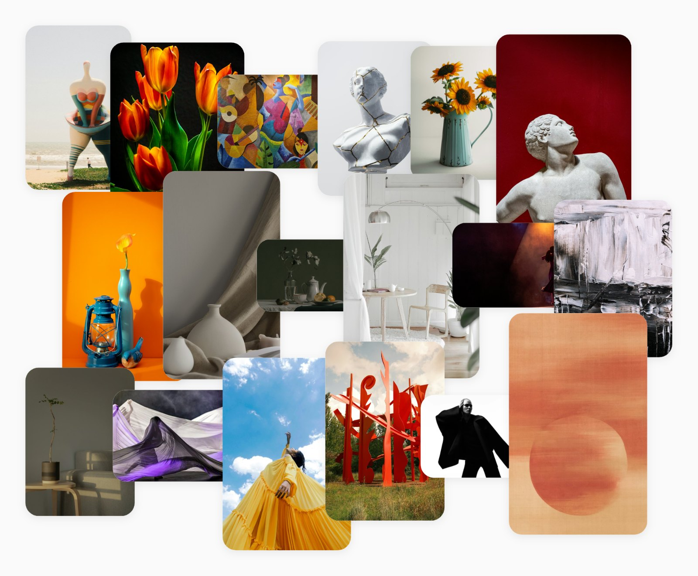

<div align="center">

# Lino

**Turn inspiration into a design starting point.**

Drop images, links, notes and colors on a board. Lino pulls a palette and fonts out of them and exports CSS variables or a Tailwind v4 `@theme`.
No account: the board lives in your browser.

[**Try it live**](https://lino-nine.vercel.app) · [Code map](MAP.md) · [API health](https://lino-api-seven.vercel.app/health)



</div>

---

## Contents

- [Why Lino](#why-lino)
- [What you can do](#what-you-can-do)
- [Quick start](#quick-start)
- [Contributing](#contributing)
- [How it's built](#how-its-built)
- [Board shortcuts](#board-shortcuts)
- [API](#api)
- [Deploy](#deploy-vercel--neon-free)
- [Accessibility](#accessibility)
- [Roadmap](#roadmap)

## Why Lino

Pinterest, Are.na and Milanote are good at *collecting* inspiration. Getting from "I have 30 references" to "I have a palette and fonts for my project" is still manual: eyedropping colors, digging through dev tools for font names, typing hex codes into a config.

Lino does that step. Paste a link and it reads the page's cover, fonts and colors. The palette panel gathers every color on the board, lets you rename, pin or hide them, and copies the result as CSS variables or a Tailwind theme.

## What you can do

- **Collect**: paste or drop images, links (they become cards with cover, title, fonts and colors) or text (becomes a note).
- **Extract**: the palette panel shows every color and font found. Rename, pin, hide or shuffle colors; preview the code before copying.
- **Export**: CSS variables (with a custom prefix) or Tailwind v4 `@theme`, colors as hex or OKLCH.
- **Pick colors**: eyedropper anywhere on screen (Chromium only) and color **harmonies** (complementary, analogous, triad) from any swatch.
- **Arrange**: grid, masonry, row, column, circle, plus the playful **sunflower**, **fan**, **collage** and **mosaic** layouts. Snapping guides, align and distribute.
- **Style**: corners, shadow, opacity, tape or pin decorations, mono/duotone image filters, note fonts (including the ones found on your links), and board themes (Paper, Kraft, Night, Blueprint).
- **Many boards**: create as many as you like, rename and delete them from the name menu at the top left.
- **Save and share**: autosave to IndexedDB, `.lino.json` export/import, **PNG download** of the whole board, and a read-only **share link**.

<details>
<summary>More detail on palette, style and file features</summary>

**Palette.** Takes a **variable prefix** for the CSS export (`--lino-color-…`; Tailwind keeps `--color-…` so its classes work) and writes colors as hex or OKLCH. Opening a swatch's picker shows its harmonies; clicking one adds it as a new swatch.

**Style** (brush icon), with elements selected:
- Any element: corners (square, soft, round), shadow, opacity, and a **tape** or **pin** decoration. **Copy style** / **Paste style** (`Ctrl+Alt+C` / `Ctrl+Alt+V`) moves a look between elements.
- Notes: background (sticky pastels, the board palette or any color), text color (automatic for contrast unless set), size S–XL, alignment, bold and italic, and the typeface: sans or serif, any **Google Font** (pick from a curated list or type any family name) or one of the fonts found on your links.
- Images: **mono** or **duotone** filter, with the duotone's shadow and highlight colors.

With nothing selected, it styles the board: themes, background color, dots/grid/plain, and **messy mode**, where new things drop in slightly tilted. Styles travel with exports, shares and the PNG.

**File menu** (folder icon): **Export board** saves a `.lino.json` with every element (images inline) and the palette edits. **Import board** (or dropping a `.lino.json` on the canvas) opens the file as a new board, so the one you had stays in your boards (an empty board is filled in place). Imported files are checked like shared boards: only http(s) links and `data:image` images, unknown fields dropped, unreadable items skipped and counted.

**Download PNG** renders the whole board (not just what is on screen) at 2× with the current theme. It is drawn on a canvas, not screenshotted, so selection outlines never show up.

**Share** uploads a copy of the board and gives a read-only link (`/board/?s=<id>`). Later edits do not change it. The shared view can pan, zoom, open links and copy the palette, and never touches the viewer's own board.

</details>

## Quick start

Needs **Node 24** and **pnpm**.

```bash
pnpm install
pnpm dev        # web on :5173, api on :3000
```

Other scripts:

```bash
pnpm typecheck
pnpm test       # vitest (web), node --test (api)
pnpm build
```

In dev, the web app calls `/api`, which Vite proxies to `:3000`.

### Sharing needs Postgres (optional)

Without `DATABASE_URL` everything else works and sharing answers 503. To enable it locally, with Docker Desktop running:

```bash
docker compose up -d   # Postgres 17 on :5432 (user/password/db: lino)
```

Then set `DATABASE_URL` in `apps/api/.env` (see the example). The API applies migrations from `apps/api/drizzle/` on start. After changing `apps/api/src/schema.ts`:

```bash
pnpm --filter @lino/api exec drizzle-kit generate
```

### Environment

Copy the examples to `.env` (both optional in dev):

| File | Variables |
| --- | --- |
| `apps/web/.env.example` | `VITE_API_URL`: the API address (defaults to `/api`) |
| `apps/api/.env.example` | `CORS_ORIGIN`: web origin allowed to call the API<br>`TRUST_PROXY=1`: set behind a proxy so rate limits see the real client IP<br>`DATABASE_URL`: for shared boards |

## Contributing

Contributions are welcome; see [CONTRIBUTING.md](CONTRIBUTING.md) for the full guide. A good way in:

1. Pick something from the [Roadmap](#roadmap), or open an issue to discuss an idea first.
2. Read [MAP.md](MAP.md): it answers "I want to change X, which file?" and is the fastest way to get oriented. Keep it updated if you add, move or rename files.
3. Skim the [ADRs](docs/adr) for decisions already made.
4. Before opening a PR, make sure these pass:

   ```bash
   pnpm typecheck && pnpm test && pnpm build
   ```

Keep the guiding rules in mind: no accounts, every board action reachable by keyboard, and anything that touches user-supplied URLs stays inside the security boundary described below.

## How it's built

A pnpm workspace with two apps:

| App | What | Tech |
| --- | --- | --- |
| `apps/web` | Landing page at `/`, the board at `/board/` (two Vite pages) | React 19, Vite, Tailwind v4, shadcn (Base UI), Zustand, IndexedDB |
| `apps/api` | Reads links for link cards; stores shared boards | Fastify 5 on Node 24, run as TypeScript directly (type stripping, no build step), Postgres + Drizzle |

```
lino/
├── apps/
│   ├── web/      # landing + board (React, Vite)
│   └── api/      # link reader + shared boards (Fastify)
├── docs/adr/     # architecture decision records
└── MAP.md        # where things live in the code
```

### Design decisions

- **No accounts.** The board autosaves to IndexedDB and never leaves the browser unless you share it. Sharing uploads an anonymous, fixed copy: no sign-up friction and no personal data to protect.
- **A hand-written API** (Fastify) instead of a managed backend, so every part can be explained. It has two jobs: reading links and storing shared boards.
- **Elements are DOM nodes with CSS transforms, not a `<canvas>`.** They are easier to style and get focus, keyboard and screen reader support for free. PNG export draws the board onto a canvas separately, so it doesn't depend on screenshots.
- **Reading links is a security boundary.** The server fetches URLs that users type, so it blocks private addresses, rechecks every redirect, pins the DNS answer (against rebinding) and caps time, size and rate. If extraction fails, the card is still created with whatever was found, and says what is missing.
- **Fonts come only from a page's CSS.** Identifying typefaces from images is a hard problem and was left out. The UI says the font list may be incomplete.
- **Shared images live inside the board's Postgres row** (data URLs in `jsonb`), not in object storage. One store, no upload flow; the 4 MB cap per board keeps it reasonable.
- **Deployed on Vercel + Neon, not Render.** Render's free tier sleeps and its free Postgres expires. See [ADR 0001](docs/adr/0001-deploy-on-vercel-and-neon.md).
- **PDF export was cut** in favor of PNG.

## Board shortcuts

| Action | Keys |
| --- | --- |
| Undo / redo | `Ctrl+Z` / `Ctrl+Shift+Z` or `Ctrl+Y` |
| Select several | `Shift`+click, `Shift`+drag on the background (selection box), `Ctrl+A` for all; `Esc` clears |
| Arrange (layout templates) | Wand button, for the selection (2+) or the whole board when nothing is selected. Sizes stay, `Ctrl+Z` undoes. Templates: **grid**, **masonry**, **row**, **column**, **circle**, **sunflower** (golden-angle spiral around the biggest piece), **fan** (a hand of cards, each showing at least 60%) **collage** (overlapping, slightly tilted, the same every time) and **mosaic** (flat, staggered rows that overlap like prints on a wall) |
| Align / distribute | Toolbar buttons with 2+ selected (distribute needs 3+); aligns visible outlines, rotation included |
| Align while dragging | Snaps to other elements' edges and centers with guide lines; hold `Alt` to move freely |
| Move selected | Arrows (`Shift` ×10), or drag any selected element |
| Resize selected | `Alt` + arrows (`Shift` ×10) |
| Rotate selected 15° | `R` / `Shift+R` |
| Delete / duplicate | `Delete` / `Ctrl+D` |
| Layer down / up | `[` / `]` (`Ctrl` for back / front) |
| Edit note, open color picker, open link | `Enter` (or double-click) |
| Copy / paste style | `Ctrl+Alt+C` / `Ctrl+Alt+V` |
| Pan / zoom | Wheel or drag the background / `Ctrl` + wheel |
| Resize with aspect lock toggled | `Shift` while resizing |
| Snap rotation to 15° | `Shift` while rotating (0°, 90°, 180° and 270° pull on their own; hold `Alt` to rotate freely) |
| Move between toolbar buttons | `←` / `→`, `Home` / `End` |

## API

| Endpoint | Description |
| --- | --- |
| `GET /health` | `{ ok: true }` |
| `GET /read?url=` | `{ url, title, image, fonts, colors, missing }` for a public page (`image` is a data URL) |
| `POST /boards` | Body `{ elements, colorMeta }` → `201 { id, expiresAt }`. Fixed snapshot kept 90 days. Max 4 MB, 300 elements, 20 shares per hour per IP |
| `GET /boards/:id` | The snapshot, or 404 when unknown or expired |

Shared boards are rendered in other people's browsers, so the body schema is strict: images must be `data:image/…` URLs, links must be http(s), colors must be hex, unknown fields are dropped. The 12-character id is random (72 bits) and is the only key.

`/read` only fetches public http(s) addresses on ports 80/443. The address is checked again on every redirect and pinned at DNS lookup, so DNS rebinding can't reach internal hosts. It has an 8 s budget, size caps and a limit of 30 reads per minute per IP.

## Deploy (Vercel + Neon, free)

Why this setup: [ADR 0001](docs/adr/0001-deploy-on-vercel-and-neon.md). Both apps deploy from the same GitHub repo as two Vercel projects.

1. Push the repo to GitHub.
2. **API project.** On vercel.com/new import the repo, set **Root Directory** to `apps/api` (Vercel detects Fastify). Deploy once.
3. **Database.** In the API project open **Storage → Create → Neon** and connect it. This adds `DATABASE_URL` and `DATABASE_URL_UNPOOLED`.
4. **Web project.** Import the same repo again with **Root Directory** `apps/web` (Vite is detected). Add `VITE_API_URL` = the API's URL (e.g. `https://lino-api.vercel.app`, no trailing slash). Deploy.
5. Back in the API project add `CORS_ORIGIN` = the web's URL (e.g. `https://lino.vercel.app`) and `TRUST_PROXY=1`, then **Redeploy**. The build (`vercel-build`) applies migrations.
6. Check `GET <api>/health` → `{ "ok": true }`, then share a board from the web.

Every push to `main` redeploys both; other branches get preview URLs. The API also runs anywhere with Docker (`apps/api/Dockerfile`) given `DATABASE_URL` and one `node src/migrate.ts`.

## Accessibility

- Every board action has a keyboard path: Tab reaches each element (the view pans to it), and moving, resizing, rotating, layering, editing and deleting all have keys.
- The canvas is a labelled region whose description lists those keys for screen readers. Elements are labelled groups ("Color #aabbcc", "Link: title"). Notices use a polite live region.
- Text contrast is at least 5.2:1 in the theme (muted text included).
- `prefers-reduced-motion` turns off the landing animation, the demo loop and every transition/animation in the board.

## Roadmap

Good places to contribute:

- [ ] **PDF export** of the board.
- [ ] **Shared-board limits.** 90-day expiry, 4 MB and 20 shares per hour per IP, but the rate limit is counted in memory per function instance. A shared store (Upstash) or firewall rules would make it real. There is no take-down flow for a link yet.
- [ ] **Smarter placement.** New elements land in the center of the view, on top of each other; placing them in free space would save a drag.
- [ ] **Self-hosted fonts.** Link fonts in notes come from Google Fonts, so choosing one sends the font name (and your IP) to Google, and proprietary fonts fall back to the default. Self-hosting or a font upload would fix both.
- [ ] **Eyedropper fallback.** It uses the browser's EyeDropper API, so it only shows in Chromium. A click-on-image fallback would cover Firefox and Safari.
- [ ] **Script-loaded fonts.** Fonts loaded by scripts (or only named in JS) are missed by link reading.

**Phase 2 candidates:** real-time collaboration, a browser extension for clipping, optional accounts to keep boards across devices, more element types (freehand drawing, richer link previews).

**Open questions:** final name and domain.

## License

[MIT](LICENSE). See [CONTRIBUTING.md](CONTRIBUTING.md) to get involved.
